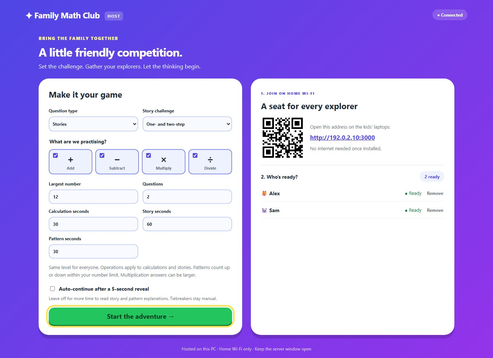
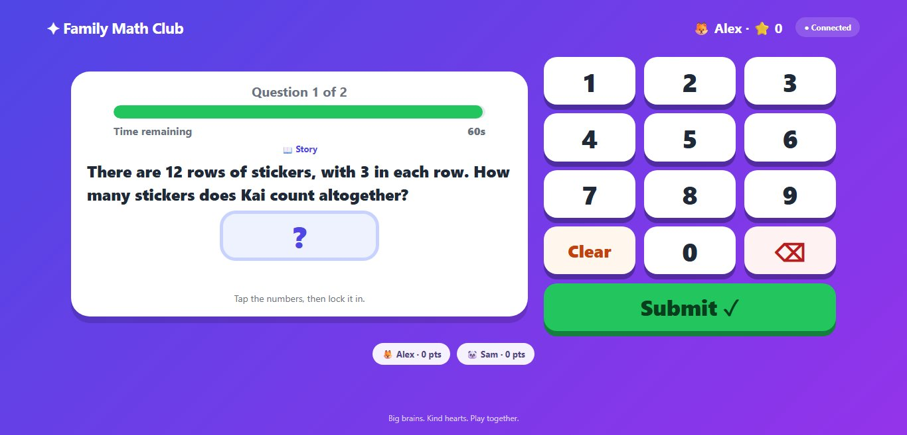
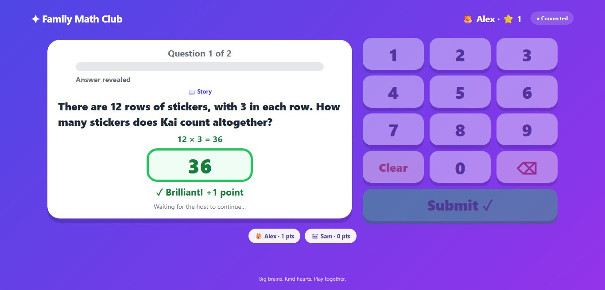
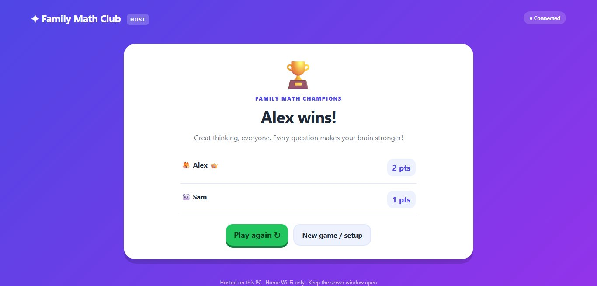

# Family Math Club

A browser-based multiplayer math quiz for a family on the same home Wi-Fi.
Your Windows PC hosts the game; the kids join from their laptop browsers.
No accounts, cloud service, AI, subscription, CDN, or internet connection during play.
The source repository is public, but running the game does **not** publish it online.

## A look inside

**Set up the family challenge.** Choose question types, difficulty, separate timers,
and optional auto-continue, then welcome players into the lobby.



**Think, then tap.** Everyone gets the same question, with a large on-screen number
pad. Play calculations, generated stories, or next/previous/missing-number patterns.



**Learn from the reveal.** Correct answers earn a point; stories and patterns show
the calculation or counting rule behind the answer.



**Celebrate the finish.** See the final scores, play again, or celebrate co-winners
when scores are tied. Solo games finish with practice results instead.



*Screenshots use fictional players and a documentation-only join address.*

## Run on your Windows PC

Install **Node.js 22 or newer** (Node 26 works). In this folder, run:

```powershell
npm install
npm start
```

Internet is needed for the initial package installation only. After that, double-click
**start-game.cmd** to start the server and open the host page. Keep the terminal
window open while playing. Stop the game with **Ctrl+C**.

Open **http://localhost:3000/host** on the host PC. The host page shows your
home-network join address, a locally generated QR code, and connected players.
If there are several addresses (for example a VPN or virtual network adapter),
use the one matching your home Wi-Fi/Ethernet network. The QR address selector
lets you change which address the code opens.

The kids open that join address, such as `http://192.168.1.20:3000`, on their
laptops, choose one of twelve animal avatars, and enter a name. Do **not** use `localhost` on their
laptops: that would point to their own computer.

Before the game starts, players can use **Change name / avatar** on their waiting
screen. The form opens with their current details; **Save changes** updates the
host roster and everyone else's lobby immediately without creating a new player.
**Cancel** keeps their previous details. Names must be 1-20 characters and unique
(ignoring case). Changes are only allowed in the lobby, not during a game.

### Windows Firewall

When Windows asks whether Node.js may communicate on networks, allow it on
**Private networks only**, not Public networks. Your trusted home connection
should be marked Private in Windows Settings > Network & internet > your
connection > Network profile. If necessary, open Windows Security > Firewall &
network protection > Allow an app through firewall and allow Node.js on Private only.
Do not disable the firewall, set up port forwarding, or expose this server to the internet.

## How to play

1. Pick **Calculations**, **Stories**, **Patterns**, or **Mix (all three)**, then the operations,
   **Max number** (5-100), and number of questions (1-50). For multiplication,
   this caps the **result**: at 50, 6 × 8 = 48 is allowed, but 48 × 49 = 2352
   is not. For addition, subtraction and division, it caps the operands instead;
   for patterns, it caps every sequence number. Set calculation time (5-120
   seconds, default **30**) and story time (15-180 seconds, default **60**)
   separately. Patterns have their own time setting (5-180 seconds, default
   **30**). Stories can be **one-step only** or **one- and two-step**.
   Defaults are calculations, all operations, numbers up to 12, and 10 questions.
   One connected player is enough for solo practice;
   join with more players for a multiplayer game.
   Optionally turn on **Auto-continue** before starting. After every reveal,
   a shared **5-second countdown** advances everyone to the next question, or
   the results after the last question. The host can press **Next now** /
   **See results now** to skip the wait. The server owns the countdown, so
   refreshing or reconnecting does not restart it. Tiebreakers remain manual.
   Auto-continue is off by default: leave it off when children need more than
   five seconds to read a story solution or pattern rule. Returning to the
   lobby cancels any pending countdown.
2. Everyone gets the **same question at the same time**. Use the large on-screen
   number pad, Clear, backspace, and Submit. Laptop number keys, Backspace,
   Delete, and Enter also work. Answers are limited to four digits.
3. Submit locks and hides the answer. If time runs out first, the last answer
   **received by the server** still counts, even without Submit. When everyone
   connected has submitted, the answer is revealed early. If a connection drops,
   only edits already saved on the server can count.
4. Correct answers earn **one point**. There is no speed bonus or penalty in
   normal play. The host sees who has submitted, but not their answers until reveal,
   then presses Next in manual mode (or waits for auto-continue). The host can
   also end a game and return to the lobby.
5. Solo practice ends with your score and number of correct answers, without a
   winner or tiebreaker. In multiplayer, highest score wins. Tied players are co-winners by default! An optional
   **Tiebreaker** offers one extra question to tied winners only. Correct beats
   incorrect; fastest correct answer wins if more than one is right. Exact
   timestamp ties remain co-winners. If nobody is right, another tiebreaker can
   be played. Saved drafts count at their last edit time. Others watch.
6. Play again keeps the players and settings and resets scores. New game returns
   to setup. The host can remove stale names from the lobby.

Questions are randomly generated on the server, not from a fixed bank. Stories
combine randomized numbers, names, items, places, and templates; no AI or
internet is involved. Both players always get the same story and time limit.
Stories practise collecting, giving away, grouping, and equal sharing.
Two-step stories chain two selected operations of the same kind (collect twice,
give away twice, groups within groups, or share twice). Each step obeys the
selected number limit and whole-number rules; a narrow range may only support
one-step stories for some operations. Mix cycles through calculations, stories,
and patterns in a randomly chosen type order, so a game of at least three
questions includes all three types;
the mixed-step option alternates one- and two-step stories when available.
On reveal, the story stays visible and the worked calculation appears underneath.
Stories never repeat verbatim within a game, although different stories can
practise the same arithmetic. Calculation questions do not repeat within a game.
Addition
and multiplication do not repeat with reversed operands. Subtraction is
non-negative; division is exact with divisors and quotients at least two.
There is no adding zero or multiplying by zero or one. Both operands are within
the chosen number limit. **Multiplication results also stay within that limit**,
in calculations and in every step of one- and two-step stories (including the
final answer). Addition, subtraction and division keep their operand limits:
for example, at 50, 48 + 49 = 97, 49 - 48 = 1 and 48 ÷ 2 = 24 are allowed.
Two-step addition stories may have a final answer above the limit, but each
step's operands stay within it.
If a selected range has too few unique questions, the host receives a clear
error. Tiebreakers draw unused questions until that pool is exhausted.

**Number patterns** ask for the next number, the number before the first shown,
or a missing number inside a sequence. Generated sequences count up or down by
a constant step (including counting by ones, twos, threes, and larger steps
when the number range permits). All five sequence numbers and the answer are
whole numbers from zero to the chosen largest number. The selected arithmetic
operations do not restrict pattern questions. Pattern rounds rotate through
next, previous, and missing formats, with randomized sequences and no repeated
prompt in a game. On reveal, the counting rule and complete sequence appear.
Small ranges have fewer unique patterns; increase the range or reduce the
question count if the host reports too few questions.

## Reconnecting and privacy

Refresh or reconnect in the same browser to recover identity, score, and the
last server-saved answer. A random identity token, name, and avatar are stored
in that browser's local storage. Use a separate browser profile/device for each
player. Players cannot join mid-game unless reconnecting.

Game state lives **in memory only**. Restarting the server clears the game and
scores. Browser identity can rejoin a fresh lobby using its remembered name.
No analytics or external requests are used. Player names and answers stay on
your network; nothing is written to the public repository.

The server accepts loopback and private IPv4 clients only. Host controls and
the host page require a loopback connection (`localhost` / `127.0.0.1`) from the
PC running Node. Kids opening `/host` over the LAN get a refusal. This is a
trusted-home-network app, **not an internet-hardened service**. Any person using
the host PC can operate host controls. Traffic is unencrypted HTTP on your LAN.

## Troubleshooting

- **Cannot connect:** keep the server running; ensure all devices are on the
  same home network; use the address shown on the host page, including `:3000`.
- **Guest Wi-Fi:** guest networks often isolate devices. Join the main trusted
  network instead. Disable client/AP isolation only if appropriate for your home.
- **VPN or multiple addresses:** try the address matching the kids' network, or
  temporarily disconnect a VPN. Reload the host page after network changes.
- **Firewall:** permit Node.js on Private networks only as described above.
- **Port already used:** stop the old server or choose a port, for example
  `$env:PORT=3001; npm start`. Join using the updated address and port.
- **Name already taken:** reconnect in the original browser, choose a different
  name, or ask the host to remove the old player in the lobby.
- **Storage disabled/private browsing:** stay on the page; identity recovery
  requires local storage to be available and retained.
- **No scrolling on a laptop:** the player question layout is designed for a
  1366 x 657 viewport at 100% zoom. Narrow displays stack the cards and may scroll.

## Development

There is no frontend build step. Node serves the plain HTML, CSS, JS, Socket.IO
client, and QR code locally.

```powershell
npm test
npx playwright install chromium
npm run test:browser
```

The first command covers generator rules and solo/multiplayer game flow with real Socket.IO
clients, including timeout drafts, scoring, tie-breaking, reconnection, and
access control. The browser check uses an isolated server and three browser
contexts (host plus two players, then solo practice), verifies the keypad and laptop viewport, and
saves lobby, question, reveal, and scoreboard PNGs to `SCREENSHOT_DIR` (defaults
to `artifacts`, ignored by Git). Playwright's browser install needs internet
once; it is not needed to run the game.
